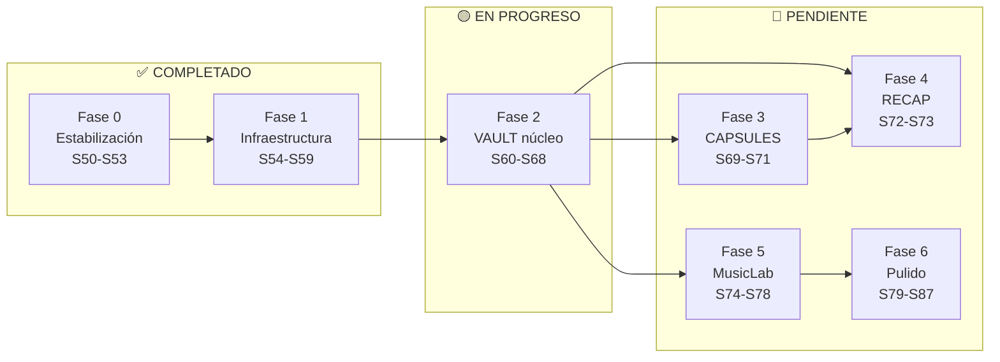
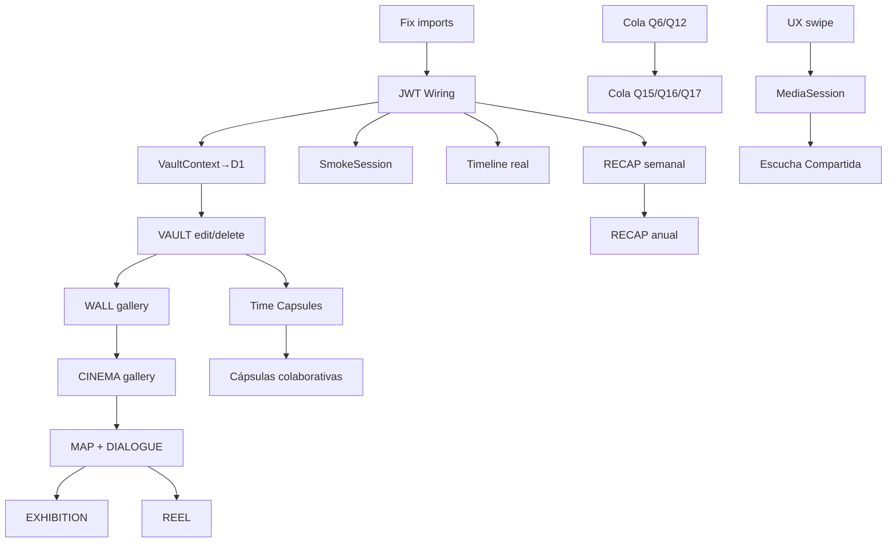

# EL BÚNKER — Roadmap de Desarrollo v3
> **Generado:** S59 — Junio 2026 · Post-auditoría
> **Actualizado:** S60-S78 planificadas con división de trabajo
> **Formato:** Sesiones Codebuff de ~45-60 min cada una

---

## 📋 Estado del Proyecto

| Métrica | Valor |
|---|---|
| **Sesiones totales planificadas** | 38 |
| **Sesiones completadas (master)** | 16 (S50-S66, S63-S64) |
| **Sesiones pendientes** | 9 (S65-S78) |
| **Sesiones diferidas (Fase C)** | 9 (S79-S87) |
| **Progreso** | `███████████░░░░░░░░░░░░░░░░░` 38% |
| **Rama activa** | `master` (desplegada en Vercel) |
| **Hito actual** | Fase 2 — VAULT núcleo |
| **Próxima sesión** | **S67** — Galería CINEMA full-bleed swipe |

---

## 🧭 Mapa de Fases



---

## 👷 División del Trabajo

| Rol | Capacidad | Sesiones | Esfuerzo |
|---|---|---|---|
| **🤖 Buffy (Codebuff)** | Edita código React, Worker API, schemas D1. Todo local. | 19 (S60-S78) | ~19h |
| **👤 Tú (Usuario)** | `git push`, `wrangler deploy`, merge a master. Solo terminal. | 6 bloques de comandos | ~10 min |
| **❌ Ninguno** | Requiere API keys externas (mapas), diseño UX nuevo, o datos reales. | Diferido a Fase C | — |

### Lo que Buffy hace en cada sesión
1. Lee el prompt de arranque (SESION.md + ESTADO.md + BACKLOG.md + INDEX.md)
2. Implementa los cambios según el pliego/spec
3. Corre lint (`npx eslint`) y code review
4. Deja commit listo en `master`

### Lo que tú haces al completar un bloque

| Bloque | Sesiones | Comandos |
|---|---|---|
| **B1** | S62-S64 (CRUD Worker) | `npx wrangler deploy` |
| **B2** ⚠️ | S64 (migración D1) | Backup JSON primero → `git push` + `npx wrangler deploy` |
| **B3** | S68 (VAULT completo) | `git push` + `npx wrangler deploy` |
| **B4** | S73 (RECAP completo) | `git push` |
| **B5** | S78 (MusicLab completo) | `git push` |
| **B6** 🏁 | **FINAL** | `git checkout master && git merge && git push origin master` |

```bash
# Tu workflow completo:
# Después de cada bloque B1-B5:
cd /mnt/c/Proyectos/el-bunker
git push
npx wrangler deploy   # solo si el bloque toca workers/

# Al final (B6):
git checkout master
git merge roadmap-completo
git push origin master   # → Vercel redeploy automático
```

---

## ✅ FASE 0 — ESTABILIZACIÓN [COMPLETADO]

| # | Objetivo | Archivos | Specs | Estado |
|---|---|---|---|---|
| S50 | Fix historial — localStorage Q2/Q3 | `PlayerContext.jsx` | Q2, Q3, Q15 | ✅ |
| S51 | Fix shuffle — solo restantes SH1 | `PlayerContext.jsx` | SH1, SH2, SH3 | ✅ |
| S52 | Fix loop — seek inicio L1 | `PlayerContext.jsx` | L1, L2, L3, L4 | ✅ |
| S53 | Cola manual Q14 + sobrevive Q10 | `PlayerContext.jsx` | Q14, Q10, Q4 | ✅ |

**Hito:** `[████████]` Reproductor sin bugs conocidos.

---

## ✅ FASE 1 — INFRAESTRUCTURA CLOUDFLARE [COMPLETADO]

| # | Objetivo | Archivos | Specs | Estado | Quién |
|---|---|---|---|---|---|
| S54 | D1 schema + Workers init + health | `workers/`, `schema.sql` | ADR-024, ADR-019 | ✅ | Ambos |
| S55 | Workers: tracks + playlists CRUD | `workers/` | ADR-024 | ✅ | Ambos |
| S56 | Workers: entries + tags + JWT | `workers/` | ADR-024 | ✅ | Ambos |
| S57 | FileUploadService + StatsEngine | `src/core/` | ADR-022, ADR-014 | ✅ | Ambos |
| S58 | Auditoría 12 bugs + fix imports | 12 archivos | — | ✅ | 🤖 |
| S59 | AddEntryForm real + VaultGallery + photo upload + Capsules sub-tab swipeable | `src/vault/`, `src/capsules/` | Taxonomía, ADR-021 | ✅ | 🤖 |

**Hito:** `[████████]` D1 + Workers + R2 operativos. VAULT con formulario real.

---

## 🟡 FASE 2 — VAULT NÚCLEO [EN PROGRESO] · 🤖 Solo Buffy

> El VAULT pasa de visual a usable. Entradas, fotos, galería WALL.

| # | Objetivo | Archivos | Specs | Depende de | 🚧 Quién | ⏱ Est. | Estado |
|---|---|---|---|---|---|---|---|
| **S60** | **Fix imports rotos** — MusicLab importa ACID desde `../layout/Layout` → `../tokens`; SmokeSession no existe en `src/capsules/` | `src/musiclab/MusicLab.jsx`, `AddTrackForm.jsx`, `PlaylistManager.jsx`, `src/capsules/Capsules.jsx` | — | — | 🤖 | ~30min | ✅ |
| **S61** | **Wiring JWT frontend** — `setUploadToken`, `setStatsToken`, fetch con jwtToken de VaultContext | `src/layout/App.jsx`, `src/core/VaultContext.jsx`, `FileUploadService.js`, `StatsEngine.js` | ADR-024 | S60 | 🤖 | ~1h | ✅ |
| **S62** | **Worker: CRUD entries D1** — GET/POST/PATCH/DELETE /api/entries | `workers/worker.js` | ADR-019 | — | 🤖 | ~1h | ✅ |
| **S63** | **Worker: CRUD eras + files** — Eras D1, listado R2 files | `workers/worker.js` | ADR-019, ADR-022 | S62 | 🤖 | ~1h | ✅ |
| **S64** | **VaultContext → Worker API** — fetchDb desde Worker, no GoogleDriveService | `src/core/VaultContext.jsx`, `GoogleDriveService.js` | ADR-024 | S61, S63 | 🤖 | ~1.5h | ✅ |
| **S65** | **VAULT editar + eliminar entradas** — Edit form, soft delete, ver detalle | `src/vault/Vault.jsx`, `AddEntryForm.jsx` | Taxonomía, EC-TR | S64 | 🤖 | ~1h | 🔴 |
| **S66** | **Galería WALL — zoom densidad** — compact/normal/expanded funcional, long-press preview | `src/vault/VaultGallery.jsx` | ADR-021 WALL | S65 | 🤖 | ~1h | ✅ |
| **S67** | **Galería CINEMA — full-bleed swipe** — Transiciones con Framer Motion, subtítulos emocionales | `src/vault/VaultGallery.jsx` | ADR-021 CINEMA | S66 | 🤖 | ~1h | 🔴 |
| **S68** | **Galería MAP + DIALOGUE** — MAP con Leaflet/placeholders, DIALOGUE alternado funcional | `src/vault/VaultGallery.jsx` | ADR-021 MAP, DIALOGUE | S67 | 🤖 | ~1.5h | 🔴 |

**Hito parcial:** `[░░░░░░░░]` VAULT con D1: crear, subir fotos, editar, galería WALL y CINEMA.

<details>
<summary><b>⚠️ Riesgos Fase 2</b></summary>

| Riesgo | Probabilidad | Impacto | Mitigación |
|---|---|---|---|
| S64 rompe compatibilidad con Drive JSON | Media | Alto | Backup del JSON antes de migrar. Rollback trivial (git revert) |
| Workers CRUD no coinciden con schema D1 actual | Media | Medio | Revisar `schema.sql` antes de implementar |
| S61 sin JWT de VaultContext → FileUploadService no funciona | Alta | Alto | Verificar que `jwtToken` existe en el context antes de cablear |

</details>

---

## 🔴 FASE 3 — CAPSULES NÚCLEO · 🤖 Solo Buffy

> Datos reales en Timeline, SmokeSession completa, Time Capsules funcional.

| # | Objetivo | Archivos | Specs | Depende de | 🚧 Quién | ⏱ Est. | Estado |
|---|---|---|---|---|---|---|---|
| **S69** | **SmokeSession migrada** — mover a `src/capsules/`, nombrar sesiones, vibe-aware, notificación push, evento Timeline | `src/smoke/SmokeSession.jsx` → `src/capsules/` | SS-1, SS-4, SS-7, SS-8 | S61 (JWT) | 🤖 | ~1h | 🔴 |
| **S70** | **Timeline con datos reales** — Filtros por Era/módulo/tipo/usuario, banner "Un día como hoy" | `src/capsules/Timeline.jsx` | ADR-020 Timeline | S61 (events API) | 🤖 | ~1h | 🔴 |
| **S71** | **Time Capsules completas** — Selector de contenido (entries + playlists), snapshot playlist, sellar con confirmación, animación apertura | `src/capsules/TimeCapsules.jsx` | TC-1 a TC-5, TC-7, TC-8 | S65 (CRUD entries) | 🤖 | ~1.5h | 🔴 |

**Hito parcial:** `[░░░░░░░░]` CAPSULES con datos reales, Smoke con notificaciones, cápsulas funcionales.

---

## 🔴 FASE 4 — RECAP · 🤖 Solo Buffy

| # | Objetivo | Archivos | Specs | Depende de | 🚧 Quién | ⏱ Est. | Estado |
|---|---|---|---|---|---|---|---|
| **S72** | **RECAP semanal + mensual** — Card compacta con stats reales desde Worker, guardable como entrada VAULT | `src/capsules/Recaps.jsx` | ADR-026 | S61 (events API) | 🤖 | ~1h | 🔴 |
| **S73** | **RECAP anual** — 6 secciones tipo Spotify Wrapped: portada, música, memoria, conexión, hitos, cierre | `src/capsules/Recaps.jsx` | ADR-026 | S72 | 🤖 | ~1.5h | 🔴 |

**Hito parcial:** `[░░░░░░░░]` RECAP semanal/mensual/anual funcional.

---

## 🔴 FASE 5 — MUSICLAB COMPLETO · 🤖 Solo Buffy

> Features restantes de la spec del reproductor v2. Cola, sesión, UX, Android, MediaSession.

| # | Objetivo | Archivos | Specs | Depende de | 🚧 Quién | ⏱ Est. | Estado |
|---|---|---|---|---|---|---|---|
| **S74** | **Cola: Q6 límite 75 + Q12 añadir playlist** | `src/core/PlayerContext.jsx` | Q6, Q12 | — | 🤖 | ~1h | 🔴 |
| **S75** | **Cola: Q15 historial scroll + Q16/Q17 soft delete** | `src/core/PlayerContext.jsx` | Q15, Q16, Q17 | — | 🤖 | ~1h | 🔴 |
| **S76** | **Sesión: S1/S2 posición + S8 localStorage** | `src/core/PlayerContext.jsx` | S1, S2, S8 | — | 🤖 | ~1h | 🔴 |
| **S77** | **UX: doble tap seek + háptico + swipe** | `src/musiclab/WinampPlayer.jsx` | UX1, UX2, UX5 | — | 🤖 | ~1h | 🔴 |
| **S78** | **MediaSession M1-M12 completo** — Notificación lockscreen, controles, seek, Cast básico | `src/core/PlayerContext.jsx`, `WinampPlayer.jsx` | M1-M12, CAST1-6 | — | 🤖 | ~1.5h | 🔴 |

**Hito parcial:** `[░░░░░░░░]` Reproductor completo según spec v2. Cola, sesión, UX, MediaSession.

---

## 🔴 FASE 6 — PULIDO Y DIFERIDO [FASE C]

> Requiere diseño UX nuevo, APIs externas, o data real. **No priorizado.**

| # | Objetivo | Archivos | Specs | 🚧 Quién | ⏱ Est. | Bloqueante |
|---|---|---|---|---|---|---|
| S79 | Escucha Compartida SC1-SC14 — corazón + sincronización vía Worker WebSocket | `src/core/PlayerContext.jsx` | SC | ❌ Nadie (WebSocket) | ~3h | Servidor WS real |
| S80 | Galería EXHIBITION — canvas 2D por vibes (Figma/Miro-like) | `src/vault/VaultGallery.jsx` | ADR-021 EXHIBITION | 🤖 | ~2h | Diseño layout |
| S81 | Galería REEL — auto-generados + pinning manual | `src/vault/VaultGallery.jsx` | ADR-021 REEL | 🤖 | ~2h | — |
| S82 | Integraciones — Drop→Entrada + link entrada→track | Varios | DA-6, DA-7 | 👤 Diseño | ~1h | Decisión UX tuya |
| S83 | Cápsulas colaborativas — snapshot playlist + ambos editan | `TimeCapsules.jsx` | DA-8, TC-9 | 🤖 | ~1.5h | — |
| S84 | Sonido ambiente CINEMA/EXHIBITION — playlist Era automática | `VaultGallery.jsx` | ADR-021 | 🤖 | ~1h | — |
| S85 | Modo offline — Service Worker cache-first para fotos + tracks | `public/sw.js` | — | 🤖 | ~1.5h | — |
| S86 | Soporte HEIC/RAW — conversión al subir | `FileUploadService.js` | — | 🤖 | ~1h | — |
| S87 | Pulido general — edge cases, rendimiento, animaciones transiciones | Varios | Varios | 🤖 | ~2h | — |

---

## 📊 Resumen de Esfuerzo

| Fase | Nombre | Sesiones | Horas | Quién | Estado |
|---|---|---|---|---|---|
| 0 | Estabilización | S50-S53 (4) | 4h | 🤖 | ✅ Completo |
| 1 | Infraestructura Cloudflare | S54-S59 (6) | 6h | 🤖 + 👤 | ✅ Completo |
| **2** | **VAULT núcleo** | **S60-S68 (9)** | **~10h** | **🤖** | **🟡 En curso** |
| **3** | **CAPSULES núcleo** | **S69-S71 (3)** | **~3.5h** | **🤖** | **🔴 Pendiente** |
| **4** | **RECAP** | **S72-S73 (2)** | **~2.5h** | **🤖** | **🔴 Pendiente** |
| **5** | **MusicLab completo** | **S74-S78 (5)** | **~5.5h** | **🤖** | **🔴 Pendiente** |
| 6 | Pulido y diferido | S79-S87 (9) | ~15h | 🤖 + ❌ | 🔴 No priorizado |

| **Total priorizado** | **Fases 2-5** | **19 sesiones** | **~21.5h** | **🤖 Solo** | |
| **Total completo** | **Fases 0-6** | **38 sesiones** | **~47h** | **🤖 + 👤** | |

---

## 🎯 Hitos del Proyecto

| Hito | Sesiones | Criterio de verificación | 🚧 Quién |
|---|---|---|---|
| ✅ **MVP funcional** | S50-S59 | App estable, VAULT con entrada real, galería básica, CAPSULES con 4 sub-tabs | 🤖 + 👤 |
| 🎯 **VAULT premium** | S60-S68 | Entradas en D1, galería WALL y CINEMA, subida de fotos real, MAP/DIALOGUE funcional | 🤖 |
| 🎯 **CAPSULES real** | S69-S71 | Timeline con eventos reales, Smoke con notificaciones, cápsulas con contenido | 🤖 |
| 🎯 **RECAP operativo** | S72-S73 | Resúmenes semanal/mensual/anual con datos reales, guardables en VAULT | 🤖 |
| 🎯 **Reproductor v2 spec** | S74-S78 | Cola completa, UX táctil, MediaSession, Cast básico | 🤖 |
| ✨ **Premium completo** | S79-S87 | 6 modos galería, escucha compartida, offline, integraciones | 🤖 + 👤 |

---

## 🔗 Dependencias Completas



---

## 📝 Protocolo de Sesión

1. **Abrir sesión:** Leer `docs/Nucleo/SESION.md` → `docs/Nucleo/ESTADO.md` → `BACKLOG.md` → `INDEX.md`
2. **Verificar:** CONTRATO.md no contradice el pliego. Si contradice, parar y reportar.
3. **Trabajar:** Implementar la sesión del roadmap. Commits atómicos por sesión.
4. **Validar:** `npx eslint src/...` — 0 errores nuevos.
5. **Cerrar:** Actualizar `SESION.md` y `ESTADO.md`. Marcar sesión como ✅ en el tracker.

---

## 📐 Convenciones de este Documento

| Símbolo | Significado |
|---|---|
| `#` | Número de sesión |
| ⚡ | Alto impacto visible para el usuario |
| 🔧 | Infraestructura, sin cambio visible inmediato |
| ✅ | Completado |
| 🟡 | En progreso |
| 🔴 | No iniciado |
| 🤖 | Lo hace Buffy (Codebuff) |
| 👤 | Lo hace el usuario (tú) |
| ❌ | No puede hacerlo nadie aún (bloqueante externo) |
| Hito | Punto de verificación con criterio definido |
